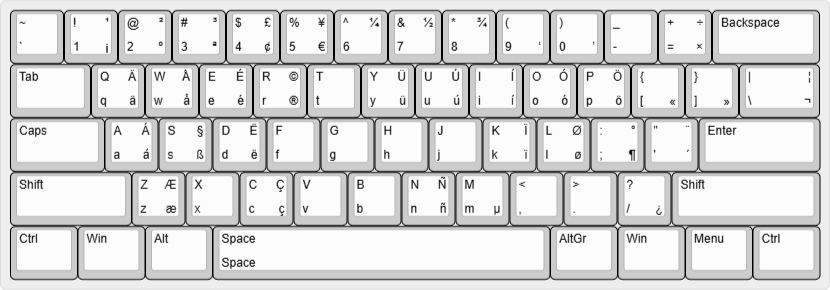

# winkbds

An assortment of custom keyboard layouts, in Microsoft Keyboard Layout Creator source code, with a few Perl scripts to convert to Máté Farkas's [Portable Keyboard Layout](https://github.com/Portable-Keyboard-Layout/Portable-Keyboard-Layout) ([GPL](GPLtools/klc2ini.pl)) for Portability, and Ian Prest's [Keyboard Layout Editor](https://github.com/ijprest/keyboard-layout-editor) ([BSL](pkl2kle.pl)), for display. 

The [Texas 1858](kbdusxtx.klc) keyboard layout, roughly based on US International without dead keys, shows a sample keyboard layout after the full conversion process:

To grasp the reason for this unusual keyboard layout name, you may read [its historical justification](texas1858.md).

Besides that, there are [Caribbean (American) English](kbdus029.klc) and [Belizean (British) English](kbdukxbz.klc) keyboard layouts available, with dead keys.

All files are covered under the Boost Software License (BSL) v1.0, unless otherwise stated.
