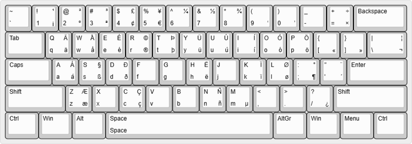

# winkbds

An assortment of custom keyboard layouts, in MicroSoft(r) Keyboard Layout Creator source code, with a few Perl scripts to convert to Máté Farkas's Portable Keyboard Layout (ini) for Portable availability and Ian Prest's Keyboard Layout Editor (json), for display. 

The [Texas 1858](kbdusxtx.klc) keyboard layout, roughly US without dead keys, shows a sample keyboard layout with full conversion process:

