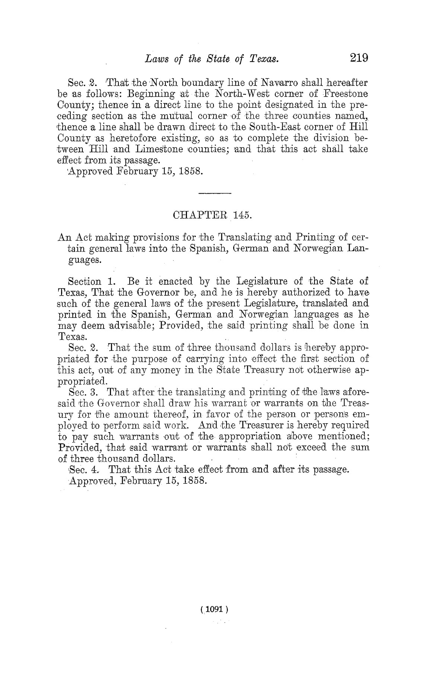

On February 15, 1858, the Texas State Legislature passed a resolution providing funds 
to translate and print some State laws into Spanish, German, and Norwegian.

So, in a sense, these languages have been, at least once, regarded as "working langugages"
of the State; this keyboard layout provides support for these three languages. 

We conmemorate this resolution by naming the Spanish_US keyboard layout for the State capital.
